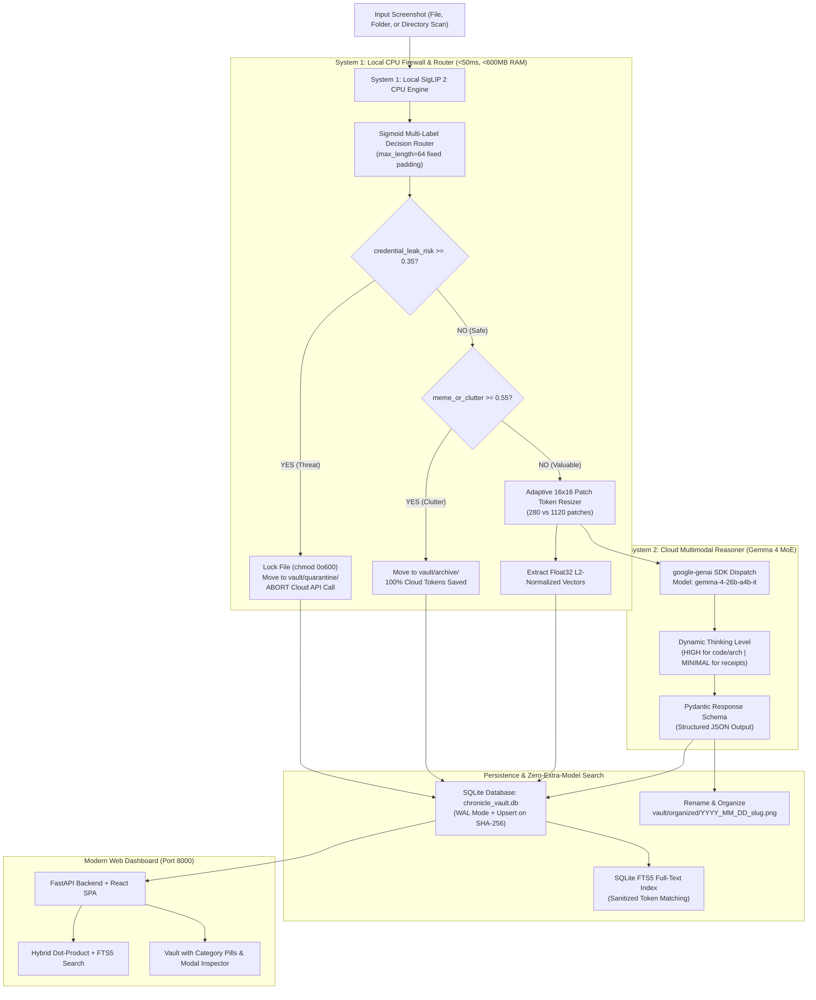

# ChronicleOS

> Autonomous, Privacy-First "Two-Brain" Screenshot Vault and Semantic Search Engine.  
> Combines local edge routing via **Google SigLIP 2** on CPU with deep multimodal reasoning via **Google Gemma 4**.

---

## 1. System Overview

Developer screenshots (`~/Pictures/Screenshots`) accumulate rapidly into an unorganized, high-risk security liability:
- Unredacted `.env` files, API credentials, and SSH keys are captured in IDE and terminal windows.
- Complex compiler errors and database stack traces are saved under generic names like `Screenshot from 2026-10-24 13-21-05.png`.
- Social media clutter and memes dilute useful technical captures, wasting cloud API tokens if analyzed naively.

**ChronicleOS** introduces a **Two-Brain Architecture** designed to balance local privacy, low resource consumption, and cloud reasoning power:

1. **System 1 (Local Edge CPU Firewall & Search Engine):**  
   Runs `google/siglip2-base-patch16-256` in `torch.bfloat16` on CPU with **under 600 MB RAM** and **sub-50ms latency**. It computes independent multi-label probabilities, intercepts credential leaks locally (`chmod 0o600`), filters clutter, resizes images into Gemma 4 patch-token buckets, and generates float32 vector embeddings.
2. **System 2 (Cloud Multimodal Reasoner):**  
   Dispatches only validated, high-value screenshots to **Gemma 4** (`gemma-4-26b-a4b-it`) via the official `google-genai` SDK. It applies dynamic thinking levels, enforces Pydantic structured output, renames files to informative `snake_case` names, and extracts actionable code fixes.

---

## 2. Technical Architecture



---

## 3. Gemma 4 Maximum Environment Utilization

ChronicleOS is built to leverage the **Gemma 4 Mixture-of-Experts** multimodal architecture (`gemma-4-26b-a4b-it`) across four dimensions:

### A. Adaptive 16x16 Patch-Token Bucketing
Gemma 4's vision encoder segments images into $16 \times 16$ pixel patches. Disorganized aspect ratios or unscaled screenshots lead to padded token waste or degraded visual resolution.  
ChronicleOS implements an **Adaptive Patch-Token Budget Gate**:
- **Dense Technical Contexts (`1120 patches`):** Stack traces, IDE screenshots, terminal outputs, and system architecture diagrams are scaled preserving aspect ratio such that $\frac{W}{16} \times \frac{H}{16} \le 1120$, providing maximum visual fidelity for character recognition and line tracing.
- **Structured Documents & Receipts (`280 patches`):** Tabular receipts, invoices, and presentation slides are scaled to $\le 280$ patches, slashing multimodal token consumption by 75% without compromising OCR accuracy.

### B. Dynamic Multi-Level Reasoning (`ThinkingConfig`)
Instead of static generation prompts, ChronicleOS modulates Gemma 4's cognitive depth based on System 1's local classification:
- **`ThinkingLevel.HIGH`:** Activated for `code_bug_or_terminal` and `architecture_or_slide`. Gemma 4 allocates explicit thinking tokens to trace stack traces, isolate root causes, and write clean reproduction fixes.
- **`ThinkingLevel.MINIMAL`:** Activated for `receipt_or_invoice`. Gemma 4 skips speculative reasoning and outputs extracted line items and vendor totals.
- **Default (Standard Inference):** For general documents, thinking overhead is omitted entirely.

### C. Native Pydantic Structured Schema Enforcement
All outputs from Gemma 4 are strictly constrained to a Pydantic schema passed via `types.GenerateContentConfig(response_schema=System2AnalysisResponse)`:

```python
class System2AnalysisResponse(BaseModel):
    suggested_filename: str = Field(..., description="Clean snake_case filename prefixed with YYYY_MM_DD")
    summary_markdown: str = Field(..., description="Technical Markdown summary of screenshot contents")
    dominant_intent: str = Field(..., description="bug_fix | architecture_reference | financial_expense | document")
    action_items: List[str] = Field(default_factory=list, description="Immediate next steps")
    code_snippets: List[str] = Field(default_factory=list, description="Copy-pasteable code fixes or commands")
    tags: List[str] = Field(default_factory=list, description="Categorical indexing tags")
```

### D. Automated Semantic Renaming & Code Extraction
Raw screenshots with generic OS timestamps are renamed to clean, human-readable file paths (e.g., `2026_10_24_sqlalchemy_pool_timeout_fix.png`). Extracted code fixes and commands are stored in dedicated JSON structures for instant copy-pasting directly from the UI.

---

## 4. System 1 Local Edge Capabilities (SigLIP 2)

- **Jev-Style Sigmoid Multi-Label Routing:** Unlike softmax (which forces mutually exclusive output probabilities that sum to 1.0), SigLIP 2 uses independent sigmoid activations ($\sigma(z_i) \in [0.0, 1.0]$). A screenshot can legitimately score high on both `code_bug_or_terminal` ($0.94$) and `credential_leak_risk` ($0.88$).
- **Fixed 64-Token Text Calibration:** SigLIP 2 was pre-trained with fixed text padding. ChronicleOS enforces `padding="max_length"`, `max_length=64`, and `truncation=True` across all label candidate vectors, ensuring calibrated probability distributions.
- **Deterministic Trust Firewall:** If `credential_leak_risk >= 0.35`, the file is moved to `vault/quarantine/`, permissions are locked to `0o600` on POSIX systems, and cloud API calls are blocked. Zero bytes of sensitive data leave the machine.
- **Clutter Filtration (Token Cost Optimizer):** If `meme_or_clutter >= 0.55`, the image is routed to `vault/archive/`, saving 100% of Gemma 4 cloud tokens.
- **Zero-Extra-Model Vector Search:** L2-normalized float32 embeddings extracted from the loaded SigLIP 2 vision encoder are persisted in SQLite as compact binary BLOBs. Visual cosine similarity is computed via vector dot product in under 1ms on CPU without loading a separate embedding model.

---

## 5. Repository Structure

```
ChronicleOS/
├── backend/
│   ├── api/
│   │   ├── routes_ingest.py       # Single, batch, folder, and path ingestion
│   │   ├── routes_search.py       # Hybrid visual & semantic search
│   │   └── routes_vault.py        # Vault records, categories, and telemetry
│   ├── core/
│   │   ├── config.py              # System thresholds and storage paths
│   │   ├── engine_system1.py      # SigLIP 2 CPU classifier, resizer & embedder
│   │   ├── engine_system2.py      # Gemma 4 client, dynamic thinking & schemas
│   │   └── vault_db.py            # SQLite database with FTS5 and upsert logic
│   └── main.py                    # FastAPI entrypoint and static SPA hosting
│
├── frontend/                      # React + TypeScript + Vite + Tailwind CSS
│   ├── src/
│   │   ├── components/
│   │   │   ├── Header.tsx         # Navigation and engine status indicator
│   │   │   ├── TelemetryBar.tsx   # Live counters (processed, quarantined, saved %)
│   │   │   ├── IngestionPanel.tsx # Multi-file/folder dropzone & probability inspector
│   │   │   ├── SearchPanel.tsx    # Hybrid search with code snippet copy
│   │   │   └── VaultPanel.tsx     # Category filters, grid view & detail modal
│   │   ├── services/api.ts        # Typed API client
│   │   ├── types/index.ts         # Shared TypeScript interfaces
│   │   └── App.tsx                # Main container
│   ├── package.json
│   └── vite.config.ts
│
├── vault/                         # Local storage vault
│   ├── organized/                 # Renamed and cataloged screenshots
│   ├── quarantine/                # Restricted access credentials (0o600)
│   └── archive/                   # Clutter and memes (0 cloud tokens)
│
├── tests/                         # Unit and integration test suite
├── chronicle_vault.db             # SQLite database with FTS5
├── requirements.txt               # Pinned Python dependencies
└── run.sh                         # Unified startup script
```

---

## 6. Installation & Setup

### Prerequisites
- **OS:** Linux (Ubuntu, Fedora, Debian, Arch), macOS, or Windows
- **Python:** 3.10, 3.11, or 3.12 (Python 3.12 recommended)
- **Node.js:** 18+ and npm 9+ (for frontend development)

### Step 1: Clone and Create Virtual Environment
```bash
git clone https://github.com/ShreyData/ChronicleOS.git
cd ChronicleOS

python3 -m venv .venv
source .venv/bin/activate
pip install --upgrade pip
pip install -r requirements.txt
```

### Step 2: Configure Environment Variables
Copy the template to `.env`:
```bash
cp .env.example .env
```
Edit `.env` to supply your Google Gemini API key:
```env
# Google Gemini API Key for Gemma 4 structured reasoning
GEMINI_API_KEY=your_gemini_api_key_here

# Backend settings
HOST=127.0.0.1
PORT=8000

# Security and Routing Thresholds
SECURITY_QUARANTINE_THRESHOLD=0.35
CLUTTER_FILTER_THRESHOLD=0.55
```

### Step 3: Pre-Cache SigLIP 2 Model Weights (One-Time)
Run this one-liner to download and verify `google/siglip2-base-patch16-256` in your local Hugging Face cache:
```bash
source .venv/bin/activate
python -c "
from transformers import AutoProcessor, AutoModel
import torch
print('Downloading SigLIP 2 model weights...')
AutoProcessor.from_pretrained('google/siglip2-base-patch16-256')
AutoModel.from_pretrained('google/siglip2-base-patch16-256', dtype=torch.bfloat16)
print('SigLIP 2 is cached and ready.')
"
```

---

## 7. Running the Application

### Option A: Unified Launcher (Recommended)
ChronicleOS serves the compiled React application directly through FastAPI on a single port:

```bash
./run.sh
```

- **Web Application:** [http://127.0.0.1:8000](http://127.0.0.1:8000)
- **Interactive OpenAPI Documentation:** [http://127.0.0.1:8000/docs](http://127.0.0.1:8000/docs)

### Option B: Manual Backend Execution
```bash
source .venv/bin/activate
uvicorn backend.main:app --host 127.0.0.1 --port 8000 --reload --reload-dir backend
```

### Option C: Frontend Development Mode (Hot-Reload)
If modifying React components in `frontend/src`:
```bash
cd frontend
npm install
npm run dev
```
Open [http://localhost:5173](http://localhost:5173). Requests to `/api` and `/vault` are automatically proxied to port 8000.

---

## 8. API Reference

| Method | Endpoint | Description |
| :--- | :--- | :--- |
| `POST` | `/api/v1/ingest/upload` | Ingest a single screenshot file through the Two-Brain pipeline. |
| `POST` | `/api/v1/ingest/upload-batch` | Batch ingest multiple screenshots or folder contents. |
| `POST` | `/api/v1/ingest/scan` | Scan any arbitrary directory path on the host. |
| `GET` | `/api/v1/search?query=...` | Execute hybrid vector dot-product + SQLite FTS5 search. |
| `GET` | `/api/v1/vault/items` | List indexed items with optional `status` and `category` filters. |
| `GET` | `/api/v1/vault/categories` | Retrieve item counts grouped by semantic category. |
| `GET` | `/api/v1/vault/quarantine` | List quarantined files with verified access permissions. |
| `GET` | `/api/v1/telemetry` | Live counters for processed count, quarantined count, and latency. |
| `GET` | `/api/health` | Service health status. |

---

## 9. Running Tests

Execute the automated test suite within the virtual environment:

```bash
source .venv/bin/activate
python -m unittest discover tests/
```

Test coverage includes:
- FTS5 special character query sanitization (hyphens, colons, quotes).
- Duplicate file SHA-256 upsert verification.
- Local quarantine file permissions.
- SigLIP 2 adaptive patch quantization logic.
- REST API endpoint contracts.

---

## 10. License

This project is licensed under the MIT License - see the [LICENSE](LICENSE) file for details.
